# Instituto Mão Amiga

App para o Instituto Mão Amiga, ONG que opera um banco de alimentos comunitário.
O app resolve a falta de visibilidade sobre os pontos de coleta e distribuição de doações.

A partir da N2, pontos de coleta e doações ficam numa API Spring Boot, que está na pasta [`api/`](api/) deste mesmo repositório. O app (Expo / React Native) fica na raiz.

## Como rodar

### API (pasta `api/`)

- Java 17 ou superior (testado com Java 17.0.20, Temurin).
- Dentro da pasta `api/`, rodar:
  - Windows (PowerShell): `.\mvnw spring-boot:run`
  - Linux/Mac: `./mvnw spring-boot:run`
- A API sobe em `http://localhost:8080`.
- Swagger: http://localhost:8080/swagger-ui/index.html
- Console do H2: http://localhost:8080/h2-console (JDBC URL `jdbc:h2:file:./data/instituto`, usuário `sa`, sem senha).
- O banco fica gravado em arquivo na pasta `api/data/`. Na primeira execução são cadastrados 25 pontos em Goiânia; nas próximas a carga não duplica. Para voltar ao estado inicial, apague a pasta `api/data/` com a API desligada.

### App

1. `npm install`
2. Em `src/services/api.ts`, trocar o IP da constante `API_URL` pelo IP do computador que está rodando a API. No Windows, o IP aparece no comando `ipconfig` ("Endereço IPv4"). O celular precisa estar na mesma rede Wi-Fi que o computador.
3. `npx expo start` e abrir no Expo Go.

O app acessa a API pelo IP do computador na rede local (não usa `localhost`), por isso funciona no celular.

**Teste da N2:** o app foi testado no navegador (`npx expo start --web`), com a API rodando no mesmo computador. Foram testados: lista com rolagem infinita e busca, cadastro, edição e exclusão de ponto, cadastro, edição e exclusão de doação, histórico com filtro e favoritos (marcar, desmarcar e continuar salvo depois de recarregar a página). No navegador a confirmação de exclusão usa a janela do próprio navegador; no celular usa o `Alert` com Cancelar e Excluir.

## API: pontos de coleta

| Método | URL | O que faz | Respostas |
|---|---|---|---|
| GET | `http://localhost:8080/api/v1/pontos` | lista todos os pontos | 200 |
| GET | `http://localhost:8080/api/v1/pontos/{id}` | busca um ponto pelo id | 200, 404 |
| POST | `http://localhost:8080/api/v1/pontos` | cadastra um ponto | 201, 400 |
| PUT | `http://localhost:8080/api/v1/pontos/{id}` | edita um ponto | 200, 400, 404 |
| DELETE | `http://localhost:8080/api/v1/pontos/{id}` | exclui um ponto | 204, 404 |

Corpo do POST e do PUT (todos os campos são obrigatórios; `tipo` é `coleta` ou `distribuição`):

```json
{
  "nome": "Paróquia São José",
  "endereco": "Rua 3, 250",
  "bairro": "Setor Oeste",
  "horario": "Ter e Qui, 14h às 17h",
  "tipo": "distribuição"
}
```

Se algum campo vier vazio, a API responde 400 com a mensagem de cada campo e não grava nada. Id que não existe responde 404.

### Prints do Swagger

**GET `/api/v1/pontos`: lista todos (200)**

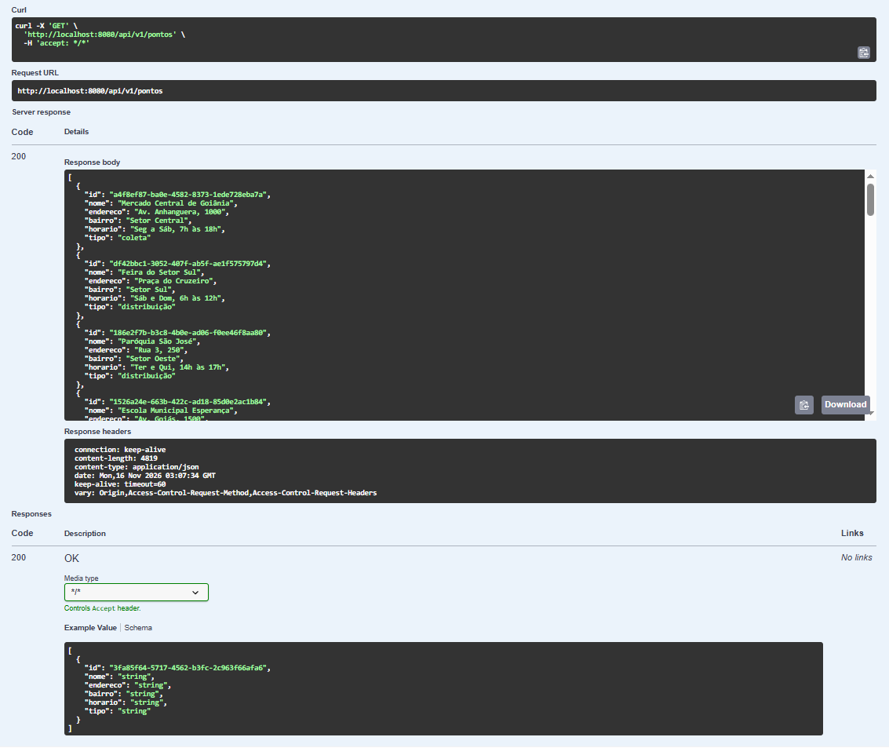

**GET `/api/v1/pontos/{id}`: busca o Mercado Central de Goiânia (200)**

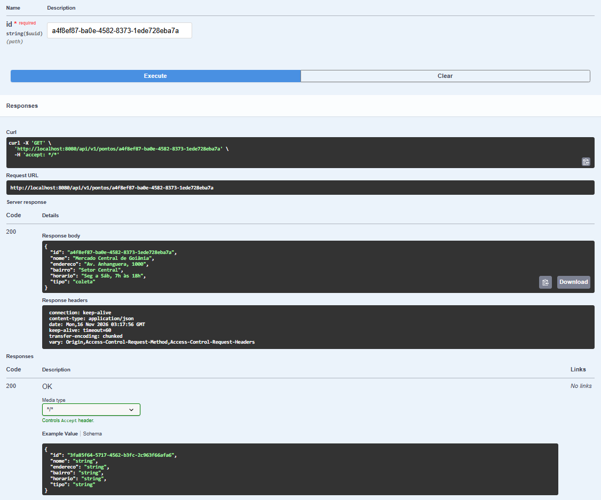

**POST `/api/v1/pontos`: cadastra o "Ponto Teste" (201)**

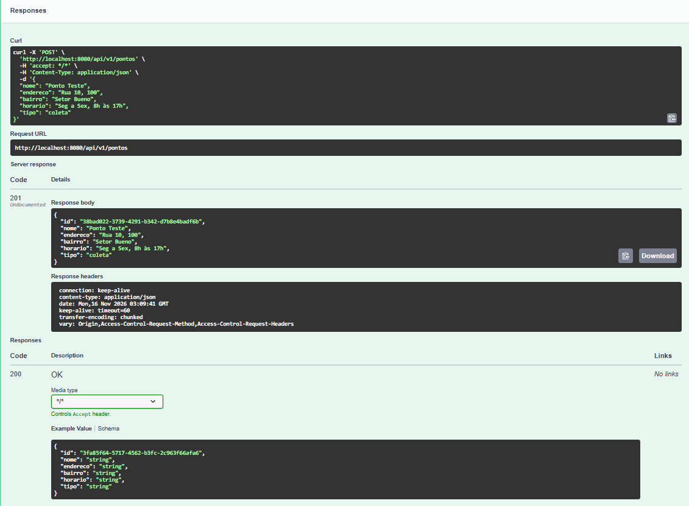

**PUT `/api/v1/pontos/{id}`: muda o horário do "Ponto Teste" (200)**

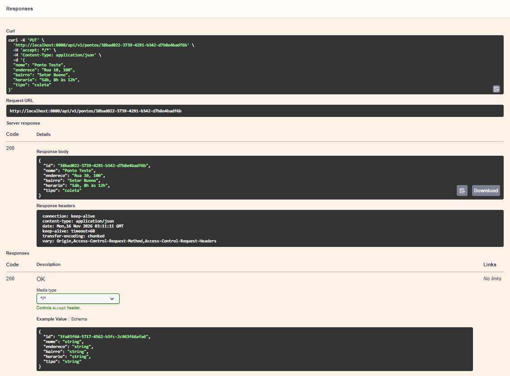

**DELETE `/api/v1/pontos/{id}`: exclui o "Ponto Teste" (204)**

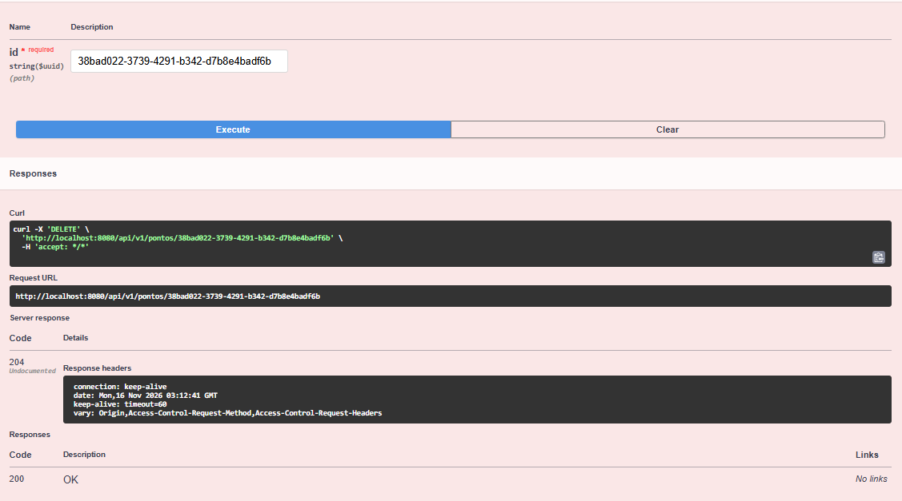

**POST `/api/v1/pontos` com `nome` vazio (400)**

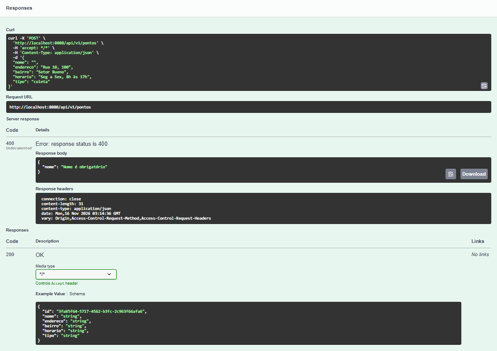

**GET `/api/v1/pontos/{id}` com id que não existe (404)**

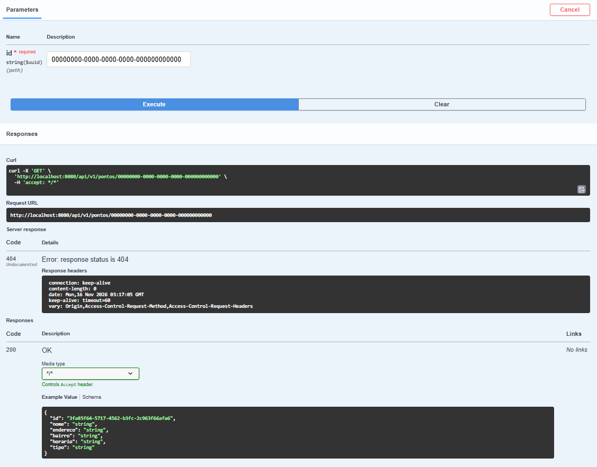

## Busca paginada de pontos

`GET http://localhost:8080/api/v1/pontos/filtro?filtro=...&page=0&size=10`

- Procura o texto no nome ou no bairro, sem diferenciar maiúsculas.
- Sem `filtro`, devolve todos os pontos paginados.
- Padrão: 10 itens por página, ordenados por nome. `sort=bairro,asc` na URL troca a ordem.
- A resposta vem no formato `content` + `page`.

Chamadas de exemplo (respostas reais da API rodando com a carga inicial):

### 1. Sem filtro

`GET http://localhost:8080/api/v1/pontos/filtro`

Primeira página com 10 pontos em ordem alfabética; `totalElements: 25` e `totalPages: 3`.

<details>
<summary>Resposta completa</summary>

```json
{
  "content": [
    {
      "id": "2b3306d0-29da-442d-a57c-23bbe70b186d",
      "nome": "Associação Jardim Novo Mundo",
      "endereco": "Rua NM-5, 45",
      "bairro": "Jardim Novo Mundo",
      "horario": "Seg a Sex, 9h às 15h",
      "tipo": "distribuição"
    },
    {
      "id": "d4fbda68-62fc-4f92-969c-c5f6328b3c75",
      "nome": "Associação Parque Atheneu",
      "endereco": "Av. Rio Verde, 2800",
      "bairro": "Parque Atheneu",
      "horario": "Ter a Sáb, 8h às 14h",
      "tipo": "coleta"
    },
    {
      "id": "1d82390b-7fb9-463d-8db2-34a9e9b7cab4",
      "nome": "Associação Setor Pedro Ludovico",
      "endereco": "Rua 1040, 55",
      "bairro": "Setor Pedro Ludovico",
      "horario": "Ter e Qui, 9h às 14h",
      "tipo": "distribuição"
    },
    {
      "id": "2a0210e9-1afc-4de9-9f34-19b7d21446ff",
      "nome": "Associação Vila Redenção",
      "endereco": "Rua VR-8, 60",
      "bairro": "Vila Redenção",
      "horario": "Seg, Qua e Sex, 8h às 14h",
      "tipo": "distribuição"
    },
    {
      "id": "76f91752-358c-41f5-9410-e5cce2ee579c",
      "nome": "CRAS Leste Universitário",
      "endereco": "Rua 230, 120",
      "bairro": "Setor Leste Universitário",
      "horario": "Seg a Sex, 8h às 17h",
      "tipo": "distribuição"
    },
    {
      "id": "c07003ea-41e3-4917-9807-c715a25a518d",
      "nome": "CRAS Sudoeste",
      "endereco": "Av. Rio Verde, 5000",
      "bairro": "Setor Sudoeste",
      "horario": "Seg a Sex, 8h às 17h",
      "tipo": "distribuição"
    },
    {
      "id": "22bb18e5-b804-45bd-8078-4b4a29ed2564",
      "nome": "Centro Comunitário Parque Amazônia",
      "endereco": "Rua PA-12, 88",
      "bairro": "Parque Amazônia",
      "horario": "Qua e Sex, 9h às 13h",
      "tipo": "distribuição"
    },
    {
      "id": "4dd09315-be9e-4803-b3f6-aedf0f015e06",
      "nome": "Centro Comunitário Vila Nova",
      "endereco": "Rua VN-7, Quadra 15",
      "bairro": "Vila Nova",
      "horario": "Seg, Qua e Sex, 9h às 16h",
      "tipo": "distribuição"
    },
    {
      "id": "848798b0-191f-4081-b07f-ff15c4ce2327",
      "nome": "Centro Espírita Setor Oeste",
      "endereco": "Rua 9, 100",
      "bairro": "Setor Oeste",
      "horario": "Qua e Sáb, 14h às 17h",
      "tipo": "distribuição"
    },
    {
      "id": "db0458db-51c7-4497-bb98-179a71d40eba",
      "nome": "Centro Social Jardim Guanabara",
      "endereco": "Rua JG-3, 90",
      "bairro": "Jardim Guanabara",
      "horario": "Seg, Qua e Sex, 8h às 12h",
      "tipo": "distribuição"
    }
  ],
  "page": {
    "size": 10,
    "number": 0,
    "totalElements": 25,
    "totalPages": 3
  }
}
```

</details>

### 2. Filtrando por bairro

`GET http://localhost:8080/api/v1/pontos/filtro?filtro=oeste`

Encontra os pontos dos bairros Setor Oeste e Setor Sudoeste; `totalElements: 3`.

<details>
<summary>Resposta completa</summary>

```json
{
  "content": [
    {
      "id": "c07003ea-41e3-4917-9807-c715a25a518d",
      "nome": "CRAS Sudoeste",
      "endereco": "Av. Rio Verde, 5000",
      "bairro": "Setor Sudoeste",
      "horario": "Seg a Sex, 8h às 17h",
      "tipo": "distribuição"
    },
    {
      "id": "848798b0-191f-4081-b07f-ff15c4ce2327",
      "nome": "Centro Espírita Setor Oeste",
      "endereco": "Rua 9, 100",
      "bairro": "Setor Oeste",
      "horario": "Qua e Sáb, 14h às 17h",
      "tipo": "distribuição"
    },
    {
      "id": "186e2f7b-b3c8-4b0e-ad06-f0ee46f8aa80",
      "nome": "Paróquia São José",
      "endereco": "Rua 3, 250",
      "bairro": "Setor Oeste",
      "horario": "Ter e Qui, 14h às 17h",
      "tipo": "distribuição"
    }
  ],
  "page": {
    "size": 10,
    "number": 0,
    "totalElements": 3,
    "totalPages": 1
  }
}
```

</details>

### 3. Segunda página

`GET http://localhost:8080/api/v1/pontos/filtro?page=1`

Os próximos 10 pontos, continuando a ordem alfabética; `number: 1`.

<details>
<summary>Resposta completa</summary>

```json
{
  "content": [
    {
      "id": "046f7a82-562b-46d6-ac4a-f1eb4a7e1f42",
      "nome": "Escola Estadual do Setor Coimbra",
      "endereco": "Rua C-180, 200",
      "bairro": "Setor Coimbra",
      "horario": "Seg a Sex, 7h às 11h",
      "tipo": "coleta"
    },
    {
      "id": "1526a24e-663b-422c-ad18-85d0e2ac1b84",
      "nome": "Escola Municipal Esperança",
      "endereco": "Av. Goiás, 1500",
      "bairro": "Setor Central",
      "horario": "Seg a Sex, 7h às 12h",
      "tipo": "coleta"
    },
    {
      "id": "96d1f443-6472-4809-8599-9c47e9318cd1",
      "nome": "Feira do Setor Campinas",
      "endereco": "Praça Campinas",
      "bairro": "Setor Campinas",
      "horario": "Dom, 6h às 12h",
      "tipo": "coleta"
    },
    {
      "id": "df42bbc1-3052-407f-ab5f-ae1f575797d4",
      "nome": "Feira do Setor Sul",
      "endereco": "Praça do Cruzeiro",
      "bairro": "Setor Sul",
      "horario": "Sáb e Dom, 6h às 12h",
      "tipo": "distribuição"
    },
    {
      "id": "b7959bee-53a3-462e-bc0b-e92ff636b2ac",
      "nome": "Igreja Jardim América",
      "endereco": "Rua C-150, 78",
      "bairro": "Jardim América",
      "horario": "Qua e Sex, 10h às 15h",
      "tipo": "distribuição"
    },
    {
      "id": "d64d2aa5-66ec-4fac-9b0f-70981d62829d",
      "nome": "Igreja Setor Universitário",
      "endereco": "Praça Universitária, 10",
      "bairro": "Setor Universitário",
      "horario": "Ter e Qui, 10h às 14h",
      "tipo": "coleta"
    },
    {
      "id": "a4f8ef87-ba0e-4582-8373-1ede728eba7a",
      "nome": "Mercado Central de Goiânia",
      "endereco": "Av. Anhanguera, 1000",
      "bairro": "Setor Central",
      "horario": "Seg a Sáb, 7h às 18h",
      "tipo": "coleta"
    },
    {
      "id": "db18711c-db80-4577-8640-e68b65950f36",
      "nome": "Mercado Setor Gentil Meireles",
      "endereco": "Rua GM-1, 300",
      "bairro": "Setor Gentil Meireles",
      "horario": "Seg a Sáb, 7h às 18h",
      "tipo": "coleta"
    },
    {
      "id": "3751cb3c-9344-493f-ad10-0eae1d87c7c6",
      "nome": "Mercado do Setor Marista",
      "endereco": "Av. 136, 800",
      "bairro": "Setor Marista",
      "horario": "Seg a Sáb, 8h às 19h",
      "tipo": "coleta"
    },
    {
      "id": "b8057120-90e5-4fc2-ae0f-65e0342b9322",
      "nome": "ONG Mãos Solidárias",
      "endereco": "Rua 15, 330",
      "bairro": "Setor Norte Ferroviário",
      "horario": "Ter a Sex, 10h às 16h",
      "tipo": "distribuição"
    }
  ],
  "page": {
    "size": 10,
    "number": 1,
    "totalElements": 25,
    "totalPages": 3
  }
}
```

</details>

## API: doações

| Método | URL | O que faz | Respostas |
|---|---|---|---|
| GET | `http://localhost:8080/api/v1/doacoes/filtro?filtro=...&page=0&size=10` | lista paginada, filtrando pelo tipo de item, da mais nova para a mais antiga | 200 |
| GET | `http://localhost:8080/api/v1/doacoes/{id}` | busca uma doação pelo id | 200, 404 |
| POST | `http://localhost:8080/api/v1/doacoes` | cadastra uma doação | 201, 400 |
| PUT | `http://localhost:8080/api/v1/doacoes/{id}` | edita uma doação | 200, 400, 404 |
| DELETE | `http://localhost:8080/api/v1/doacoes/{id}` | exclui uma doação | 204, 404 |

Corpo do POST e do PUT:

```json
{
  "tipoItem": "Arroz",
  "quantidade": 10,
  "pontoDestino": "Mercado Central de Goiânia"
}
```

`quantidade` precisa ser maior que zero; `tipoItem` e `pontoDestino` não podem ser vazios (senão 400). O campo `criadoEm` é preenchido pela API no cadastro e não muda na edição.

### Prints do Swagger

**GET `/api/v1/doacoes/filtro`: lista paginada, da mais nova para a mais antiga (200)**

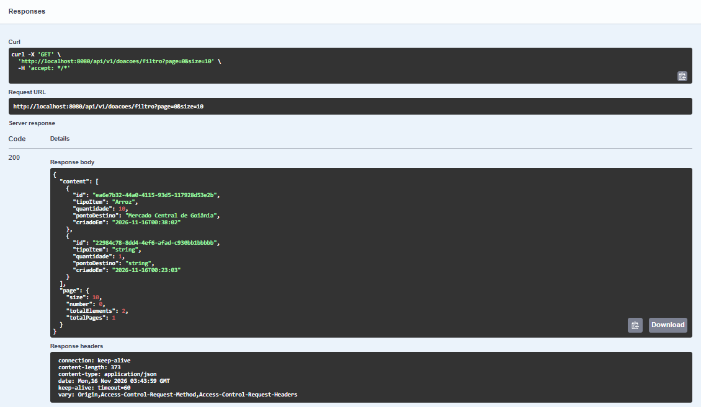

**GET `/api/v1/doacoes/{id}`: busca uma doação (200)**

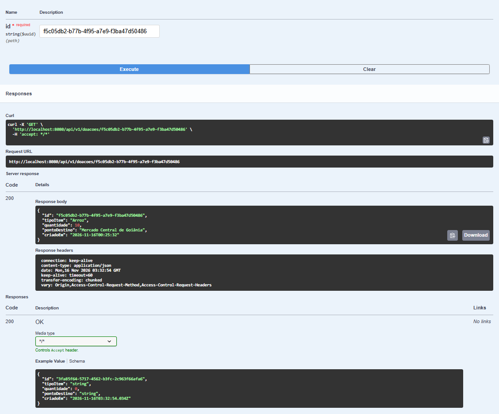

**POST `/api/v1/doacoes`: cadastra 10 de Arroz; o `criadoEm` vem da API (201)**

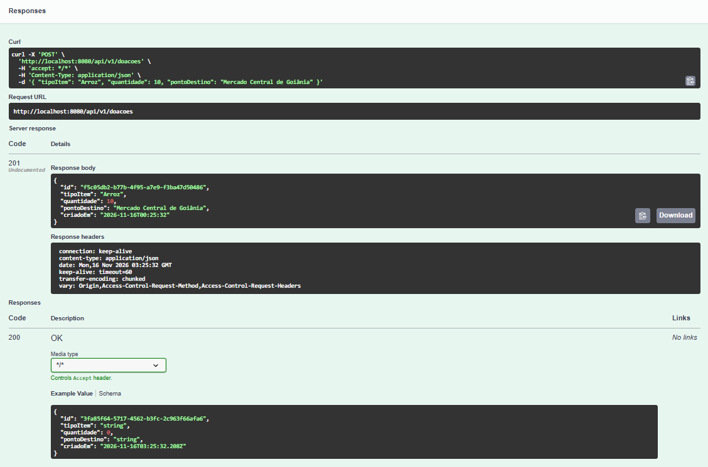

**PUT `/api/v1/doacoes/{id}`: muda a quantidade para 25 e mantém o mesmo `criadoEm` (200)**

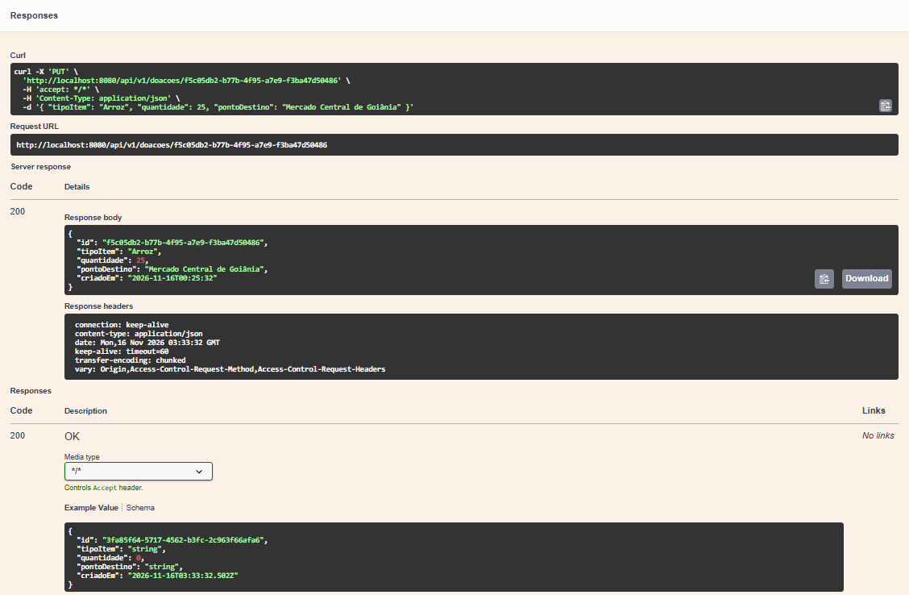

**DELETE `/api/v1/doacoes/{id}`: exclui a doação (204)**

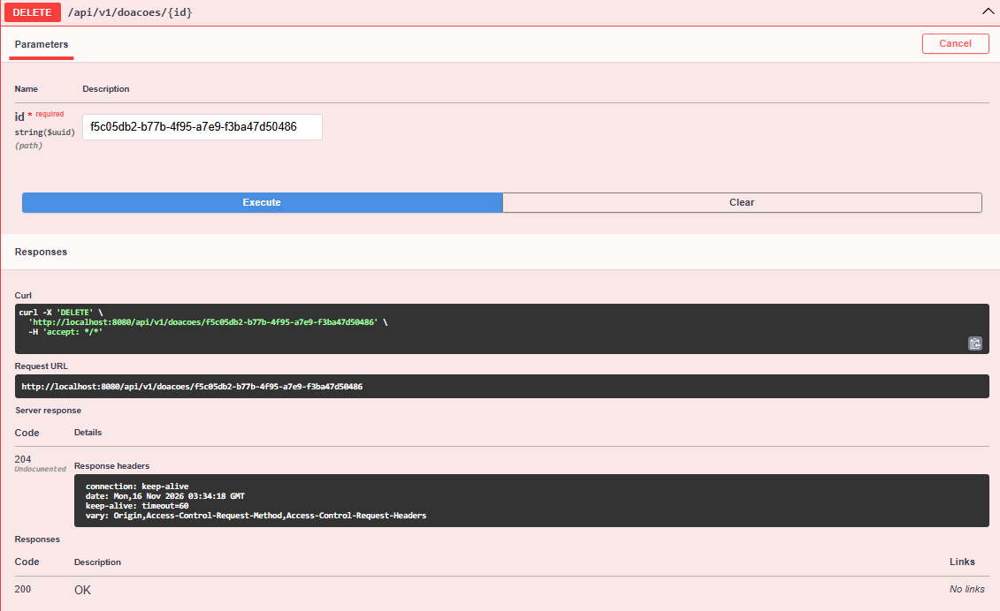

**POST `/api/v1/doacoes` com quantidade 0 (400)**

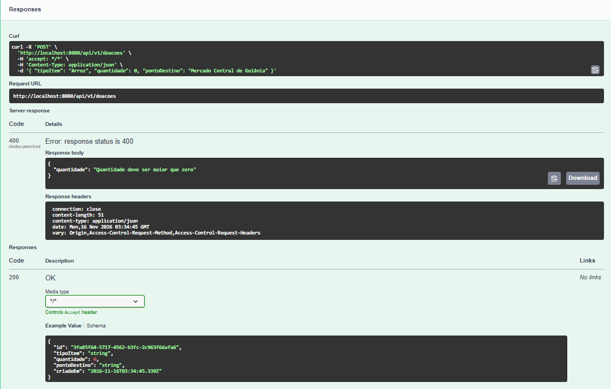

**GET `/api/v1/doacoes/{id}` com id que não existe (404)**

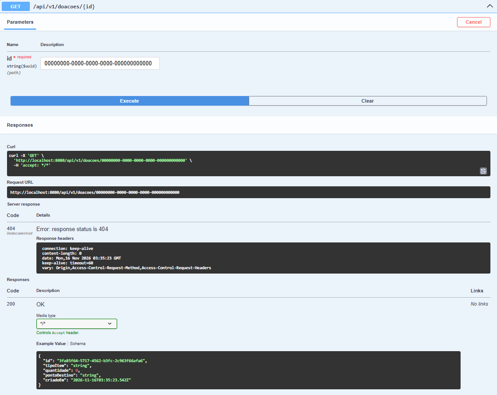

## Roteiro de demonstração (até 3 minutos)

1. **API (30s)**: no Swagger, fazer um POST de ponto com o `nome` vazio e mostrar o **400**; fazer um GET de ponto com um id que não existe (ex.: `00000000-0000-0000-0000-000000000000`) e mostrar o **404**.
2. **Buscar (15s)**: no app, digitar `oeste` na busca e tocar em Buscar. Limpar a busca e rolar a lista para mostrar a rolagem infinita carregando mais pontos.
3. **Cadastrar ponto (20s)**: "+ Novo Ponto", preencher, escolher o tipo e cadastrar. Buscar pelo nome para mostrar que ele está na lista.
4. **Editar ponto (20s)**: abrir o ponto, "Editar", mudar o horário, "Salvar alterações". O detalhe já mostra o valor novo.
5. **Excluir ponto (15s)**: "Excluir", tocar em Cancelar primeiro, depois Excluir de verdade. O ponto some da lista.
6. **Favoritar (20s)**: tocar no ♡ de dois pontos, abrir "♥ Meus Pontos", desmarcar um deles.
7. **Cadastrar doação (20s)**: "+ Nova Doação", tipo `Arroz`, quantidade `20`, escolher o ponto de destino e cadastrar. Abrir o histórico: ela aparece no topo.
8. **Editar doação (20s)**: tocar na doação, "Editar", mudar a quantidade, "Salvar alterações". Detalhe e histórico mostram o valor novo e a data de cadastro continua a mesma.
9. **Excluir doação (15s)**: no detalhe, "Excluir", confirmar. Volta para o histórico e a doação sumiu.

## Decisões técnicas

- **Favoritos no aparelho, pontos e doações no servidor.** Pontos e doações são dados do instituto: todos que usam o app precisam ver a mesma coisa, então ficam na API. Favoritos são uma escolha de cada pessoa, por isso ficam no AsyncStorage do próprio celular. Guardo só os ids e busco os dados atualizados na API; assim, se um ponto for editado, o favorito mostra os dados novos, e se for excluído ele simplesmente fica de fora.
- **DTOs na API.** O controller recebe um `RequestDTO` (com as validações) e devolve um `ResponseDTO`, nunca a entidade. Assim o app não consegue mandar um `id` ou uma data de cadastro, e a validação fica num lugar só.
- **Data de cadastro no servidor.** O `criadoEm` é preenchido no service com `LocalDateTime.now()`. Se viesse do app, cada celular poderia mandar uma data diferente (ou errada).
- **Rede em camadas no app.** Só `src/services/api.ts` chama `fetch`; as telas usam `pontosService` e `doacoesService`. Se o IP da API mudar, troca em um lugar só.
